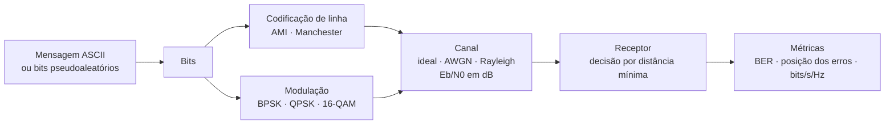
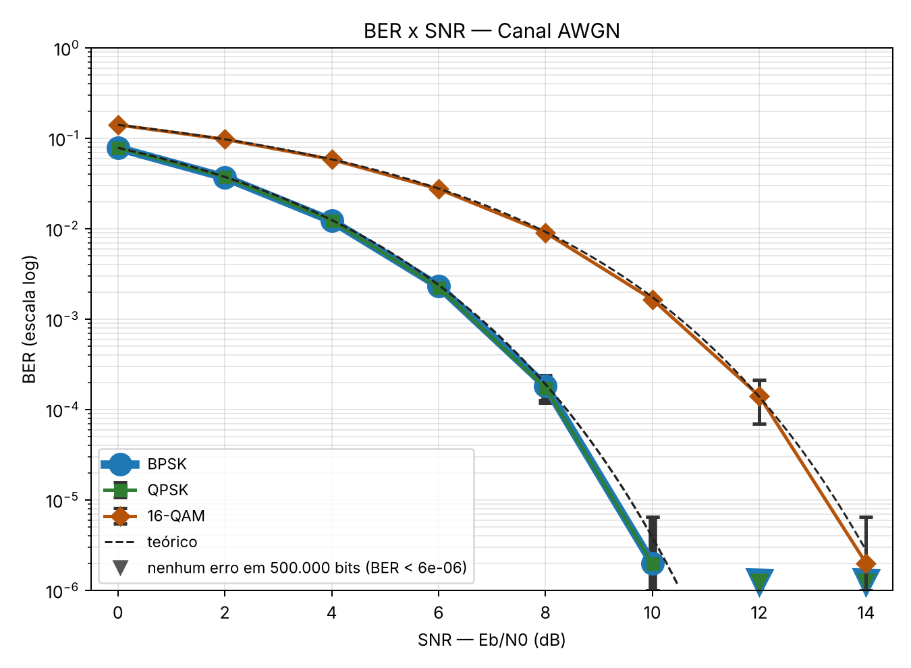
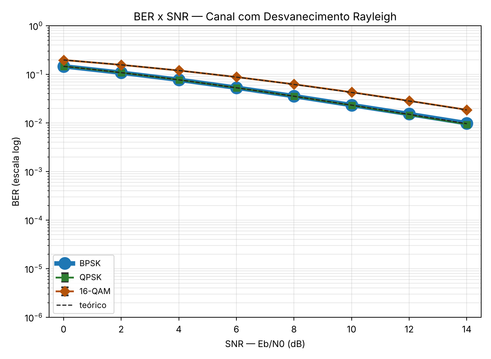
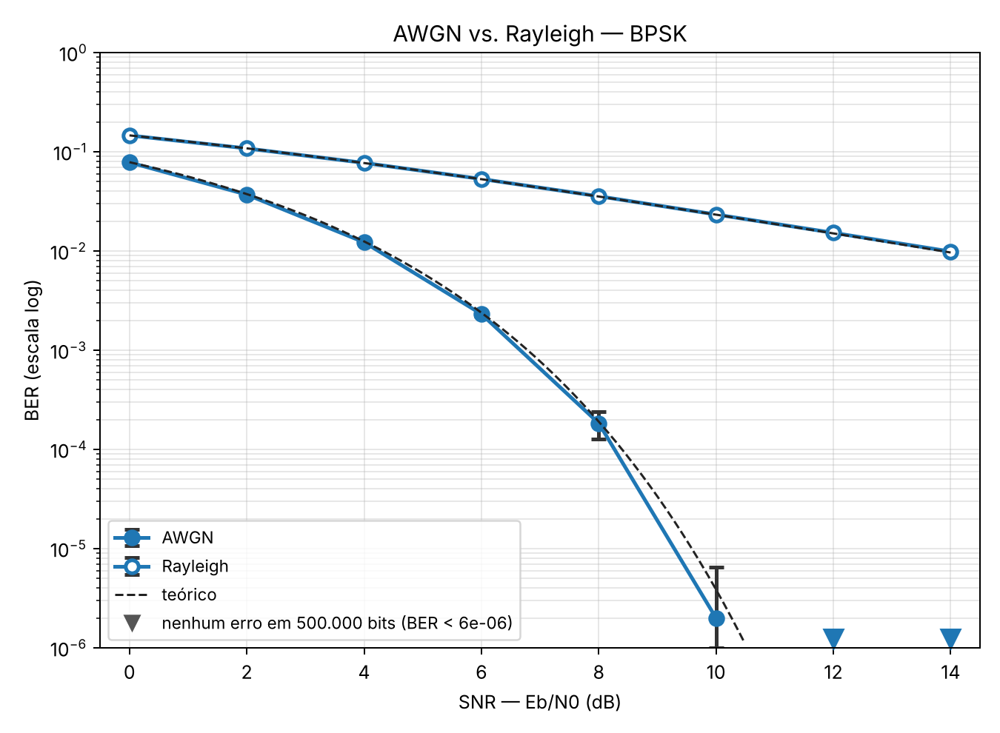
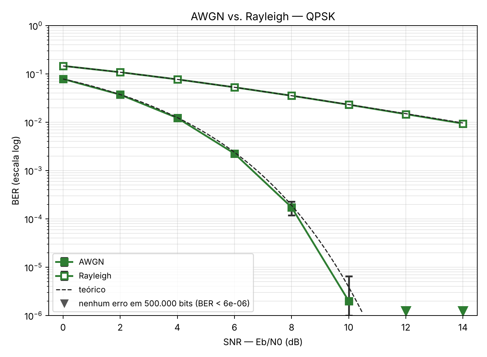
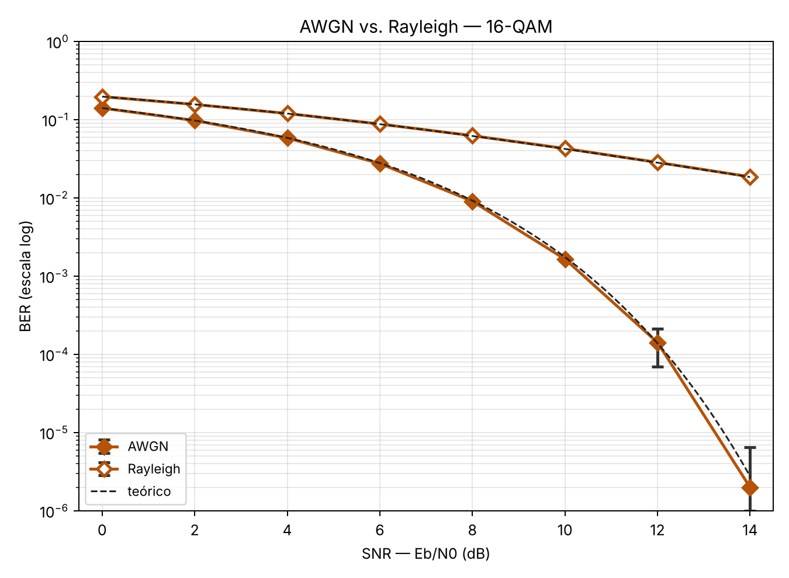
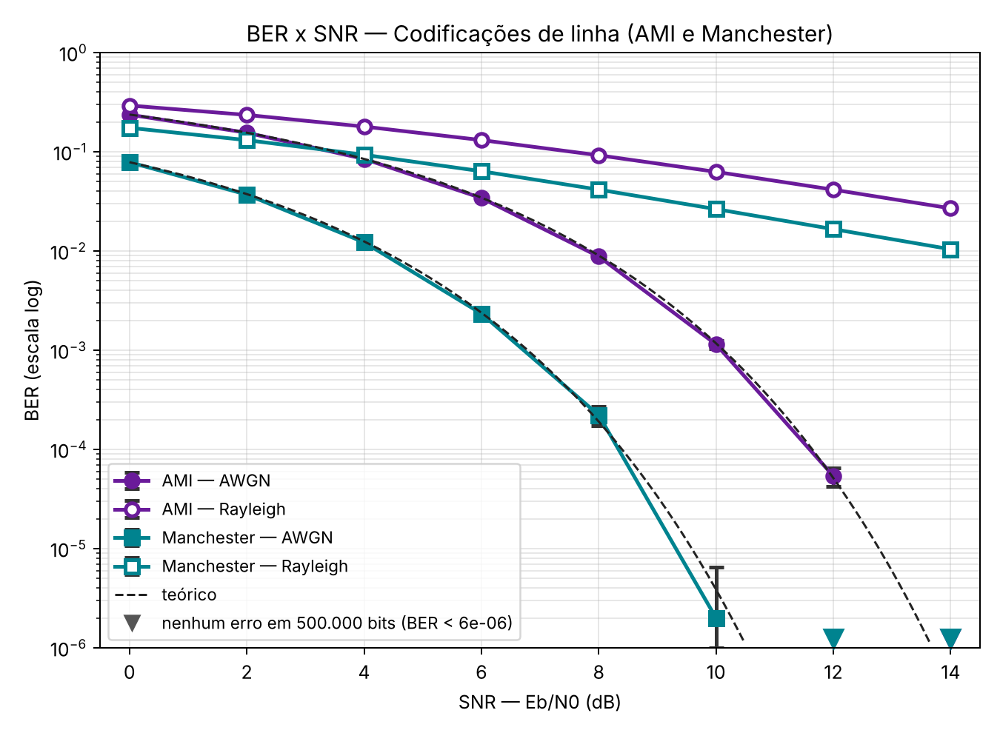
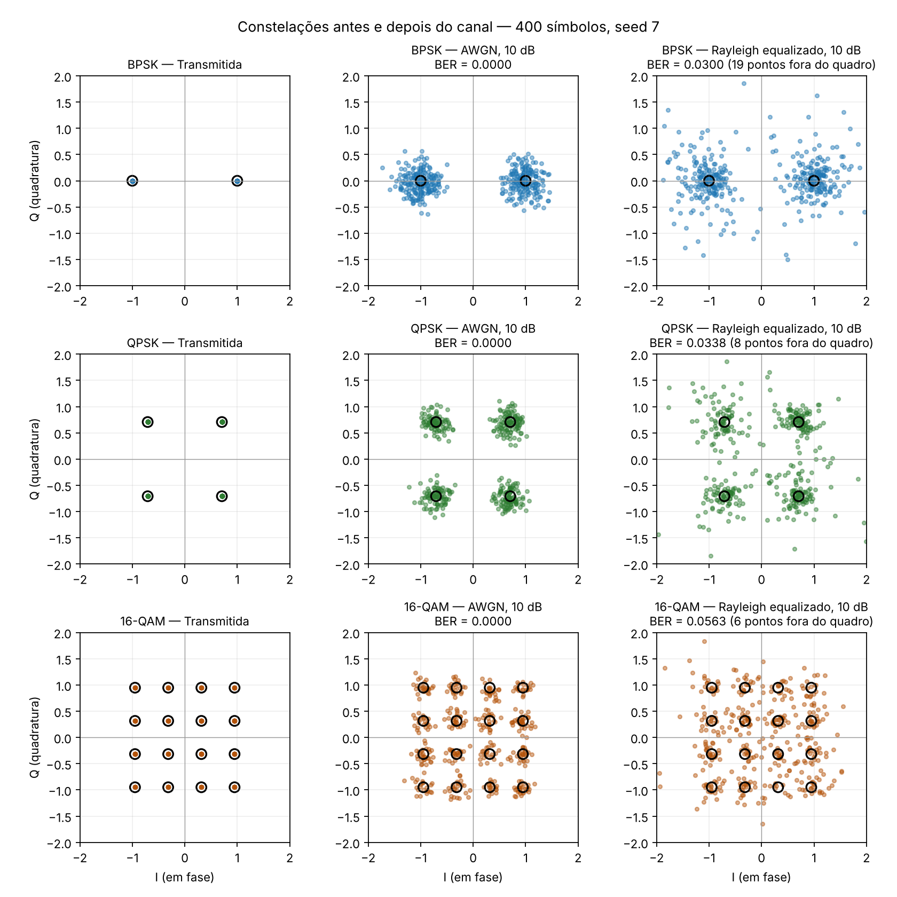

# Simulador de transmissão digital ponta a ponta

Trabalho II (Grau B) da disciplina **Redes de Computadores** — UNISINOS, 2026/2
Professor: Cristiano Bonato Both

**Dupla:** Arthur Rambor e Leonardo Taborda

Simulador de um enlace de comunicação digital completo — mensagem, codificação
de linha ou modulação, canal ruidoso, recepção e métricas — com um plano
experimental reproduzível que mede o compromisso entre taxa de erro de bits
(BER) e eficiência espectral.

> **Vídeo de demonstração:** 

---

## 1. O que foi pedido e o que foi implementado

| Enunciado | Implementação | Onde |
| --- | --- | --- |
| Gerar mensagem ASCII e converter em binário | Texto ↔ bits (UTF-8, MSB primeiro) e sequência pseudoaleatória com seed | `src/geracao.py` |
| Duas codificações de linha | AMI e Manchester | `src/codificacao_linha.py` |
| Três modulações, uma de ordem superior | BPSK, QPSK e 16-QAM, com código Gray e energia média Es = 1 | `src/modulacao.py` |
| Canal AWGN com controle de SNR e um segundo cenário | AWGN e desvanecimento Rayleigh plano, ambos parametrizados por Eb/N0 (dB); canal ideal para validação | `src/canal.py` |
| Demodular, decodificar, reconstruir e identificar bits incorretos | Decisão por distância mínima; índices dos bits errados; mensagem recebida | `src/simulate.py`, `src/metricas.py` |
| BER e eficiência espectral nominal | `erros / bits` e bits por símbolo (bits/s/Hz) | `src/metricas.py` |
| ≥ 8 valores de SNR, ≥ 100.000 bits, ≥ 5 repetições | 8 valores (0 a 14 dB), 100.000 bits, 5 seeds | `experiments/run_experiment.py` |
| Curvas BER × SNR com variabilidade | Média e barra de erro (desvio padrão amostral) | `results/figures/` |
| Comparar AWGN e o segundo cenário | Um gráfico por modulação + exemplo de mensagem recuperada | `results/figures/`, `results/raw/exemplo_mensagem.txt` |
| Tabela de compromisso BER × eficiência | Tabela em Eb/N0 = 8 dB | `results/raw/tabela_compromisso_snr8db.csv` |
| Teste de consistência | Canal ideal + SNR de 30 dB, com diagnóstico das divergências | `tests/test_consistency.py` |
| Registrar configurações e resultados brutos | CSV por simulação + `configuracao.json` | `results/raw/` |
| Opcional: constelações e curvas teóricas | Ambos implementados | `src/teoria.py`, `results/figures/constelacoes.png` |

## 2. Arquitetura



Todo o caminho é executado por uma única função, `simular()`, em
`src/simulate.py`. Cada execução recebe uma seed, que controla o ruído e o
desvanecimento.

```
src/
  geracao.py            mensagem <-> bits; bits pseudoaleatórios com seed
  codificacao_linha.py  AMI e Manchester (encode, decode)
  modulacao.py          BPSK, QPSK e 16-QAM (modulate, demodulate)
  canal.py              awgn() e rayleigh(), parametrizados por Eb/N0
  metricas.py           BER, localização de erros, eficiência espectral
  teoria.py             curvas teóricas de BER para validação
  simulate.py           pipeline ponta a ponta + linha de comando
tests/
  test_consistency.py   canal ideal e SNR elevada, com diagnóstico
experiments/
  run_experiment.py     grid completo -> CSVs, figuras e tabelas
results/
  raw/                  resultados brutos, agregados e configuração
  figures/              gráficos gerados
```

## 3. Instalação

Requer Python 3.10 ou superior.

```bash
git clone https://github.com/ArthurRambor/RedesTrabalhoGB.git
cd RedesTrabalhoGB
python3 -m venv .venv && source .venv/bin/activate   # opcional
pip install -r requirements.txt
```

## 4. Execução

```bash
# tudo de uma vez: autotestes, teste de consistência e grid experimental
./run_all.sh

# ou passo a passo
python3 tests/test_consistency.py        # validação funcional
python3 experiments/run_experiment.py    # 400 simulações, ~10 s; gera results/
```

Uma simulação isolada, pela linha de comando (a partir de `src/`):

```bash
cd src
python3 simulate.py --mensagem "Ola, UNISINOS!" --modulacao qpsk --canal awgn --snr-db 8
python3 simulate.py --mensagem "Ola, UNISINOS!" --modulacao qpsk --canal rayleigh --snr-db 8
python3 simulate.py --mensagem "Teste" --codificacao manchester --canal awgn --snr-db 5
python3 simulate.py --n-bits 100000 --seed 1 --modulacao 16qam --canal rayleigh --snr-db 12
```

A saída mostra bits transmitidos, bits errados, BER, eficiência espectral, a
mensagem recebida e as posições dos bits incorretos.

## 5. Parâmetros do experimento

| Parâmetro | Valor |
| --- | --- |
| Modulações | BPSK, QPSK, 16-QAM |
| Codificações de linha | AMI, Manchester |
| Canais | AWGN, Rayleigh |
| SNR | Eb/N0 = 0, 2, 4, 6, 8, 10, 12, 14 dB |
| Bits por execução | 100.000 |
| Repetições | 5 (seeds 100 a 104, as mesmas em todas as combinações) |
| Bits por ponto da curva | 500.000 |
| Total | 240 simulações de modulação + 160 de codificação de linha |
| Variabilidade | desvio padrão amostral da BER entre as 5 repetições |

Todos os valores ficam no topo de `experiments/run_experiment.py` e são
gravados em `results/raw/configuracao.json`.

### Premissas de modelagem

- **A SNR é sempre Eb/N0** (energia por bit sobre densidade de ruído). É o que
  mantém "parâmetros equivalentes" entre modulações com números diferentes de
  bits por símbolo: `Es/N0 = Eb/N0 × bits_por_simbolo`, `N0 = Es / (Es/N0)`,
  desvio padrão do ruído por dimensão `= sqrt(N0/2)`.
- **Energia média normalizada.** Es = 1 em todas as modulações. Na codificação
  de linha o canal usa a energia média por amostra de cada código (0,5 no AMI,
  em que metade das amostras é zero; 1,0 no Manchester).
- **Rayleigh:** desvanecimento plano, independente a cada símbolo, com
  `E[|h|²] = 1` e AWGN somado. O receptor conhece `h` (CSI perfeito) e equaliza
  por divisão (zero-forcing de 1 tap).
- **Eficiência espectral nominal:** bits por símbolo, supondo taxa de símbolo
  igual à banda (Nyquist ideal). É um teto, sem filtro real nem banda de guarda.
- **Manchester:** bit 1 = alto→baixo (convenção de G. E. Thomas). A IEEE 802.3
  usa o mapeamento inverso; o desempenho é o mesmo.

## 6. Codificação de linha × codificação de correção de erros

**Codificação de linha** define como cada bit vira sinal no meio físico. Ela
resolve problemas do sinal, não dos dados: o AMI elimina a componente contínua
alternando a polaridade dos pulsos; o Manchester garante uma transição no meio
de cada bit, o que permite recuperar o relógio, ao custo do dobro de banda.
Nenhuma das duas acrescenta redundância.

**Codificação de correção de erros** (Hamming, por exemplo) acrescenta bits de
paridade calculados sobre os dados, para que o receptor detecte e corrija bits
que o canal corrompeu.

Uma não substitui a outra. O teste de consistência mostra isso na prática: um
bit transmitido em AMI chega errado mesmo em 30 dB, e nada no receptor permite
corrigi-lo.

## 7. Resultados

### 7.1 Teste de consistência

`python3 tests/test_consistency.py`

- **Canal ideal:** as 5 técnicas reconstroem a mensagem sem nenhum erro. O
  mapeamento de bits está correto.
- **Eb/N0 = 30 dB:** 9 de 10 combinações reconstroem a mensagem sem erro.
- **Divergência explicada:** AMI no canal Rayleigh, 1 bit em 544 (índice 117;
  "consistencia" chega como "consiwtencia"). Naquele instante o ganho do canal
  era `|h| = 0,0198`. A equalização divide por `h` e amplifica o ruído cerca de
  50 vezes; o nível zero do AMI chega como −0,865 e ultrapassa o limiar de
  decisão (0,5). É o efeito de amplificação de ruído do zero-forcing em
  desvanecimento profundo, não um defeito do código. O AMI é o mais exposto
  porque o nível zero fica a apenas meia amplitude do limiar.

### 7.2 BER × SNR no canal AWGN



- BPSK e QPSK têm a mesma BER por bit: o QPSK são dois BPSK em quadratura.
- O 16-QAM precisa de cerca de 4 dB a mais para a mesma BER.
- Os pontos simulados caem sobre as curvas teóricas (tracejadas).
- Onde não houve nenhum erro em 500.000 bits, o ponto é um triângulo no piso do
  gráfico: significa BER < 6 × 10⁻⁶ com 95% de confiança, não uma BER medida.
- A variabilidade relativa cresce quando a BER cai: em 0 dB o desvio é cerca de
  1% da média; em 8 dB, cerca de 30%, porque restam menos de 30 erros por
  execução.

### 7.3 BER × SNR no canal Rayleigh e comparação com AWGN



| | | |
| --- | --- | --- |
|  |  |  |

- Em 8 dB, a BER do BPSK passa de 1,8 × 10⁻⁴ (AWGN) para 3,6 × 10⁻² (Rayleigh):
  quase 200 vezes pior com a mesma SNR média.
- A forma da curva muda. No AWGN a BER cai exponencialmente com a SNR; no
  Rayleigh cai menos de 10 vezes a cada 10 dB, porque os erros se concentram
  nos instantes de desvanecimento profundo. Não há piso de erro: a curva
  continua caindo, só que devagar.
- Na recuperação da mensagem (`results/raw/exemplo_mensagem.txt`, QPSK, 14 dB):
  no AWGN a mensagem chega intacta; no Rayleigh, "UNISINOS Redes de
  Computadores 2026" chega como "UNISINOC Redes0de Computalopes 2026".

### 7.4 Compromisso entre BER e eficiência espectral (Eb/N0 = 8 dB)

| Modulação | Eficiência nominal (bits/s/Hz) | BER em AWGN | BER em Rayleigh | Mais adequada quando |
| --- | --- | --- | --- | --- |
| BPSK | 1 | 1,84 × 10⁻⁴ | 3,57 × 10⁻² | Sem vantagem sobre o QPSK neste modelo ideal |
| QPSK | 2 | 1,74 × 10⁻⁴ | 3,54 × 10⁻² | SNR baixa ou média: melhor equilíbrio |
| 16-QAM | 4 | 9,07 × 10⁻³ | 6,25 × 10⁻² | SNR alta: a partir de uns 12 dB em AWGN |

- O QPSK dobra a eficiência do BPSK sem custo em BER.
- Dobrar de novo, para 16-QAM, multiplica a BER por cerca de 50 em AWGN.
- No Rayleigh as três ficam ruins e próximas (fator 1,8 entre QPSK e 16-QAM):
  quem domina é o canal, não a modulação.

### 7.5 Codificações de linha



| Codificação | Eficiência nominal (bits/s/Hz) | BER em AWGN, 8 dB | BER em Rayleigh, 8 dB |
| --- | --- | --- | --- |
| AMI | 1 | 8,81 × 10⁻³ | 9,23 × 10⁻² |
| Manchester | 0,5 | 2,22 × 10⁻⁴ | 4,16 × 10⁻² |

O Manchester, decodificado pela diferença entre as duas metades do bit, é um
sinal antipodal e tem a mesma BER do BPSK em AWGN. O AMI usa três níveis com um
limiar a meia amplitude e paga cerca de 3 dB por isso. Em troca, o Manchester
ocupa o dobro de banda.

### 7.6 Constelações antes e depois do canal



### 7.7 Simulado × teórico

`results/raw/simulado_vs_teorico.csv` compara ponto a ponto. Exemplos em 8 dB:

| Esquema | Canal | Simulado | Teórico |
| --- | --- | --- | --- |
| BPSK | AWGN | 1,84 × 10⁻⁴ | 1,91 × 10⁻⁴ |
| 16-QAM | AWGN | 9,07 × 10⁻³ | 9,25 × 10⁻³ |
| BPSK | Rayleigh | 3,57 × 10⁻² | 3,55 × 10⁻² |
| 16-QAM | Rayleigh | 6,25 × 10⁻² | 6,20 × 10⁻² |
| AMI | AWGN | 8,81 × 10⁻³ | 9,01 × 10⁻³ |

As fórmulas estão documentadas em `src/teoria.py`.

## 8. Conclusões

1. **Eficiência espectral se paga em SNR.** Cada bit a mais por símbolo aproxima
   os pontos da constelação; o 16-QAM leva 4 bits por símbolo e pede cerca de
   4 dB a mais que BPSK e QPSK.
2. **O canal pesa mais que a modulação.** O desvanecimento Rayleigh piora a BER
   em quase 200 vezes em 8 dB e muda a inclinação da curva; aumentar a potência
   média resolve pouco.
3. **Codificação de linha não protege os dados.** Sem codificação de correção
   de erros, um único desvanecimento profundo corrompe a mensagem mesmo em SNR
   alta.

## 9. Reprodutibilidade

O grid é determinístico: as seeds são fixas e `run_experiment.py` regrava os
mesmos CSVs byte a byte.

```bash
python3 experiments/run_experiment.py
md5sum results/raw/*.csv
```

```
8246f7716dd8728488e60ba90c92a3b2  resultados_agregados.csv
b6a816f684082da6cb761f0063df23dd  resultados_brutos.csv
d63a0b7197e9f2ba7ebb6d0c362683ef  resultados_linha_agregados.csv
5289e4bb2fbb8ebc0798258650942aad  resultados_linha_brutos.csv
6e2d2e769f08b77c4f2ad21fd0410505  simulado_vs_teorico.csv
21fbac02abb6dddbb6cf48004f460057  tabela_compromisso_snr8db.csv
```

| Arquivo em `results/raw/` | Conteúdo |
| --- | --- |
| `resultados_brutos.csv` | uma linha por simulação de modulação (240) |
| `resultados_agregados.csv` | média, desvio, mínimo e máximo por (modulação, canal, SNR) |
| `resultados_linha_brutos.csv` | uma linha por simulação de codificação de linha (160) |
| `resultados_linha_agregados.csv` | agregados das codificações de linha |
| `tabela_compromisso_snr8db.csv` | BER × eficiência espectral em 8 dB |
| `simulado_vs_teorico.csv` | BER simulada e teórica, ponto a ponto |
| `exemplo_mensagem.txt` | mensagem de texto recuperada em cada canal |
| `configuracao.json` | todos os parâmetros do experimento |

## 10. Limitações

- CSI perfeito no receptor; sistemas reais estimam o canal com pilotos.
- Sem sincronismo de símbolo, erro de fase ou filtro de formatação de pulso.
- Sem codificação de correção de erros nem diversidade, que são as técnicas
  usadas na prática contra o desvanecimento.
- Abaixo de BER ≈ 10⁻⁵, 500.000 bits por ponto dão poucos erros e a incerteza
  relativa é alta.

## 11. Divisão de responsabilidades

| Integrante | Responsabilidades |
| --- | --- |
| Arthur Rambor | Sistema e método: geração de dados, codificações de linha, modulações, modelos de canal e pipeline (`src/`); plano experimental e teste de consistência; análise dos resultados em AWGN |
| Leonardo Taborda | Resultados e interpretação: análise das codificações de linha, do canal Rayleigh e da comparação com AWGN; constelações e exemplo de mensagem; tabela de compromisso BER × eficiência espectral; limitações e conclusões |

Documentação, vídeo e revisão do código foram feitos em conjunto.

A apresentação oral segue a mesma divisão, com metade do tempo para cada um:
Arthur apresenta o sistema, o método, a validação e o resultado em AWGN;
Leonardo apresenta os demais resultados, a interpretação, as limitações e as
conclusões.
